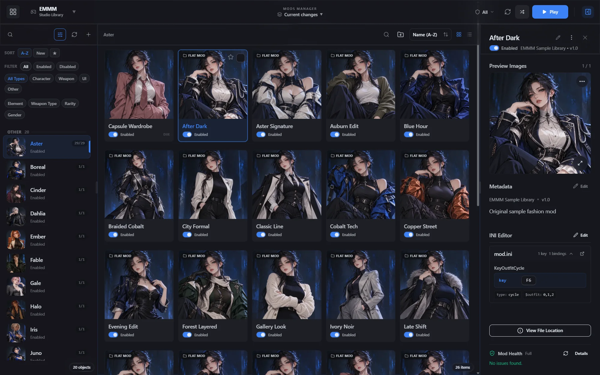
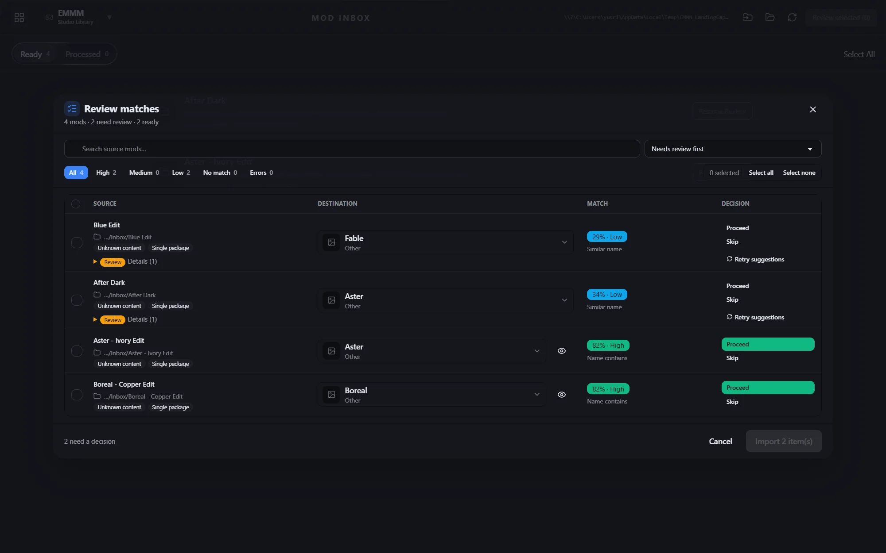
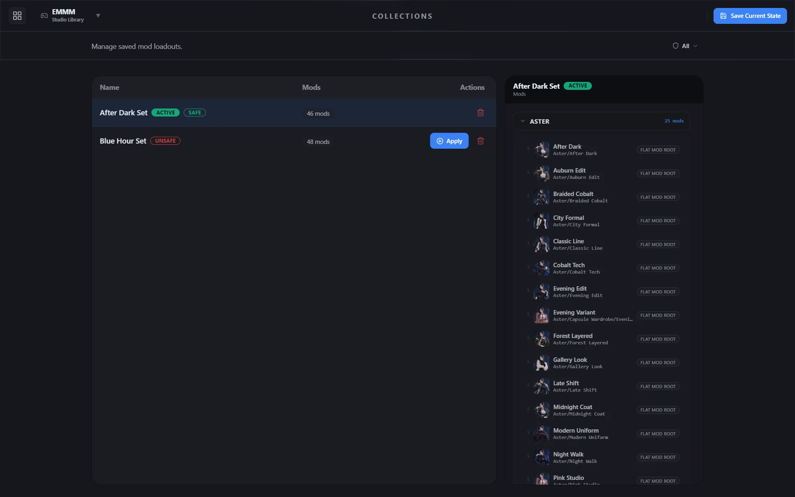
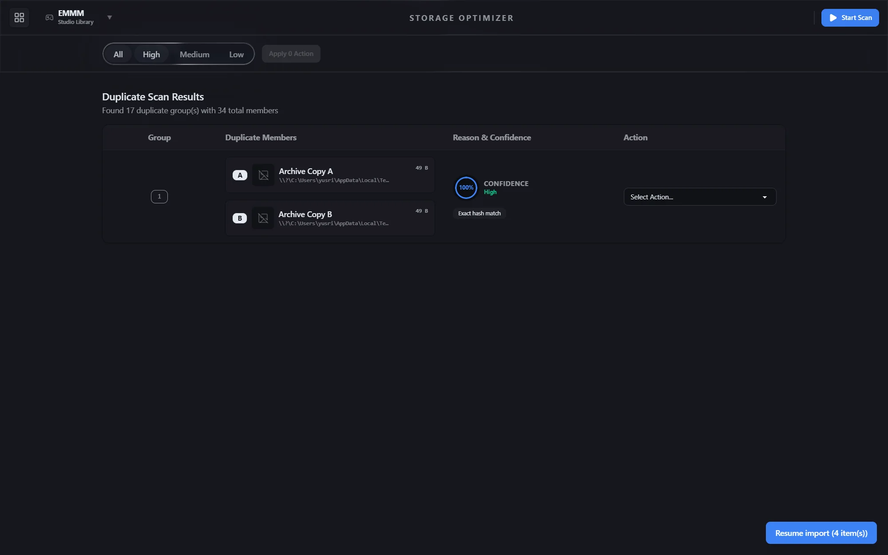

# EMMM — 3DMigoto Mod Manager

EMMM is an open-source Windows desktop manager for GIMI, SRMI, ZZMI, WWMI, and EFMI mod libraries. Point it at the folders you already use, even when they span multiple locations. Keep your layout; EMMM works with it.

[Features](#what-you-can-do) · [Build from source](#setup) · [Support development](https://ko-fi.com/reynalivan)



_The screenshots use a sample library created for the landing page. EMMM does not include the pictured mods or game content._

EMMM is an independent third-party project. It is not affiliated with, endorsed by, or sponsored by any game, game developer, publisher, or platform mentioned in this repository.

## What you can do

### Import and classify mods

Drop a mod folder or a `.zip`, `.7z`, or `.rar` archive into Mod Inbox. EMMM finds mod roots inside nested downloads and suggests where each one belongs. It checks available INI hashes, installed catalog records, aliases, and folder names. Review uncertain matches and destinations before import; catalog data can also add available metadata and thumbnails.



### Work with your own folders

Browse by game and object in grid or list view, open nested folders, and use breadcrumbs to go back. Search and filter by name, category, and available metadata. Pin or star favorites, enable or disable individual mods, use **Enable Only This** to compare alternatives in a group, or act on several mods at once. A `DISABLED ` folder prefix records the enabled state on disk, while SQLite indexes the library for browsing.

EMMM watches relevant folder, INI, metadata, and image changes, so edits made in File Explorer can be reconciled with the app's view.

### See your mods and controls

EMMM detects images in mod folders. Choose a preview or paste a thumbnail from the clipboard; edit metadata and inspect INI files in the app. Detected keybinds from active mods appear in a searchable view. For supported runtime matches, the optional in-game KeyViewer shows bindings and status; **F7** toggles the overlay.

### Save setups with Collections

Save collections and switch between them while the game is in the foreground with **Shift+F5** and **Ctrl+F5**. Preview what will change before applying a collection. **F5** toggles Safe Mode, which limits the active setup to mods you have classified as Safe.



### Review duplicate files

Storage Optimizer groups duplicate files for review. Choose what to keep, ignore, move to trash, or hardlink after checking the results.



The normal **Remove Mod** action sends the folder to the OS Recycle Bin. Keep a separate backup before large imports or reorganizations.

## Catalog data

EMMM can use an optional catalog pack for known identities, aliases, hashes, available metadata and images, and reviewed KeyViewer runtime targets. In the app, open **Settings > Catalog Assets** to review and install a local `catalog-pack.zip`. Once installed, you can check for signed updates from the source declared by that pack. Catalog coverage differs by game and entry; matching suggestions still need your review.

## Getting started

EMMM is currently developed for Windows. The source and build instructions are below. Check [Releases](https://github.com/reynalivan/EMMM2/releases) for published builds.

## Architecture

EMMM is a Tauri v2 application with a React and TypeScript frontend and a Rust backend. The frontend uses TanStack Query for server state, Zustand for local application state, and TanStack Virtual for large collections. The Rust side owns filesystem operations, archive processing, hashing, database access, and Tauri commands.

The core safety model is intentionally simple:

1. The filesystem determines whether a mod is enabled.
2. SQLite is an index and metadata store, not a competing source of truth.
3. File mutations use recoverable workflows and reconciliation when an operation fails or the library changes outside EMMM.
4. Removed content goes through the trash flow rather than an immediate hard delete.

## Repository layout

```text
src/             React application
src-tauri/       Rust services, database, and Tauri shell
tests/           Unit and browser end-to-end tests
docs/            Requirements, test cases, architecture notes, and history
scripts/         Development and release helpers
```

## Prerequisites

- Node.js 22 through 24
- Corepack, which provides the pinned pnpm 11.19.0 release
- Rust stable and Cargo
- Windows is required for the native desktop workflow

## Setup

Run the setup script from PowerShell to validate the required runtimes, install locked frontend dependencies, and fetch Cargo crates.

```powershell
.\setup.ps1
```

Start the desktop application:

```powershell
pnpm tauri dev
```

`pnpm tauri dev` prepares an isolated development catalog pack from a sibling checkout. Set `EMMM_DEV_CATALOG_SOURCE` to use another local catalog source. The command stops if the pack or its manifest is invalid so the development profile cannot silently run with incomplete catalog data.

## Common commands

| Command                                             | Purpose                                               |
| --------------------------------------------------- | ----------------------------------------------------- |
| `pnpm dev`                                          | Start the frontend-only Vite server.                  |
| `pnpm tauri dev`                                    | Start the desktop application with the native bridge. |
| `pnpm build`                                        | Type-check and build the frontend.                    |
| `pnpm tauri build`                                  | Create the desktop application bundle.                |
| `pnpm test --run`                                   | Run the Vitest suite once.                            |
| `pnpm test:e2e`                                     | Run WebdriverIO browser end-to-end tests.             |
| `pnpm lint`                                         | Run ESLint.                                           |
| `pnpm lint:arch`                                    | Check frontend architecture boundaries.               |
| `pnpm format`                                       | Format supported files with Prettier.                 |
| `cargo test --manifest-path src-tauri/Cargo.toml`   | Run Rust tests.                                       |
| `cargo clippy --manifest-path src-tauri/Cargo.toml` | Run Rust static analysis.                             |

## Configuration

Copy `.env.example` to `.env` only when you need local GameBanana or observability integration. Keep `.env` local. It can contain credentials and is not part of the repository.

## Documentation

- [Project introduction](docs/intro.md)
- [Requirements](docs/requirements)
- [Test cases](docs/test-cases)
- [Architecture and migration notes](docs/relocation.md)
- [Contribution and agent guidance](AGENT.md)

## Status

This repository is under active development. Check the requirements and test cases before relying on a workflow that is important to your mod library.
