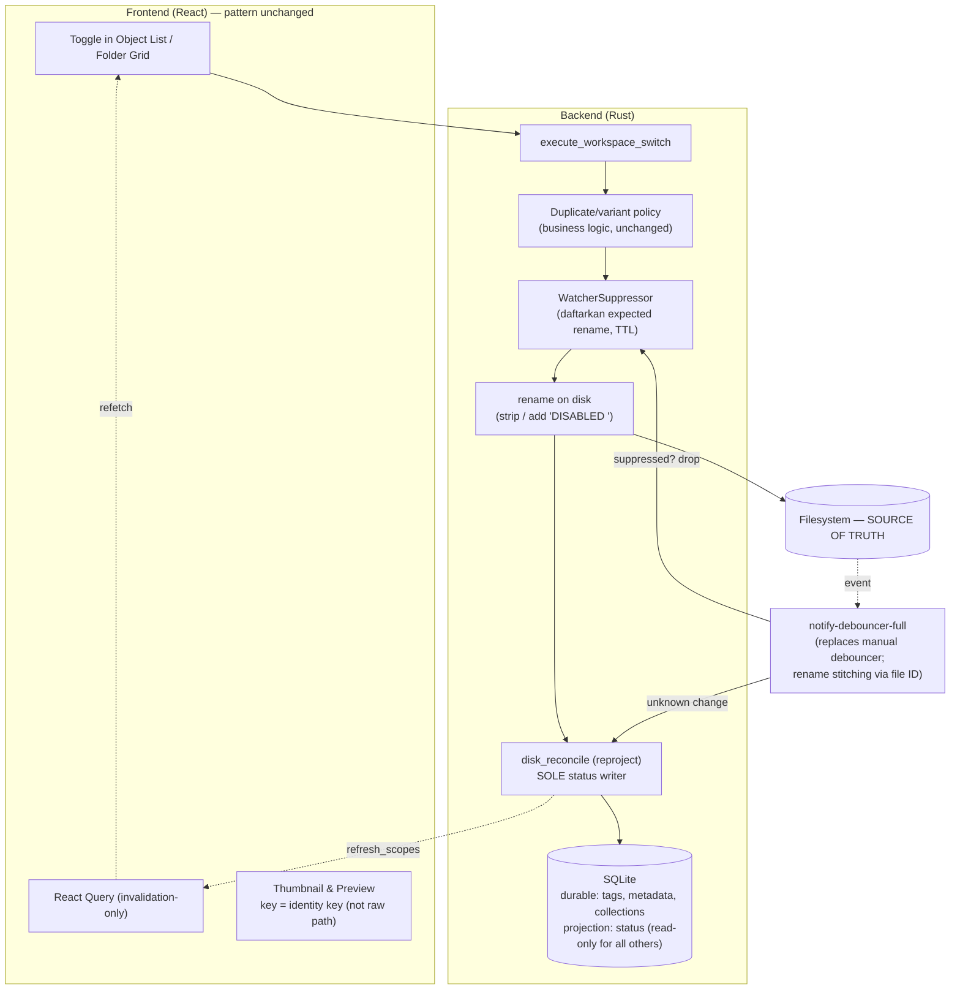

# Enable/Disable v2 — Disk as the Source of Truth

> **Status: FULLY IMPLEMENTED (2026-08-09) + gap audit passed.** All 9
> steps in §6 are complete; the `status_is_written_by_disk_reconcile_only`
> gate is active. Follow-up audits addressed missing reconciliation in archive
> extraction, manual import, drag-and-drop, and trash restore without a
> `game_id`; reconciliation scope for cross-root implicit swaps and partial
> organizer-move failures; the latent `UpdateObjectInput.status` writer (the
> Edit Object dialog toggle was removed—writing status without a rename would
> be reverted by reconciliation); frontend thumbnail keys are now
> identity-based; and the basename `pathRewrite` fallback that could corrupt
> selection for mods with identical names was removed. Known remaining debt:
> (a) double refetch per toggle (`disk_reconcile:result` plus switch publish—
> this needs a deduplication design, not a quick fix), (b) selection comparison
> remains case/separator-sensitive in some places, (c) the broad flow still
> uses blanket suppression by design, and (d) scan commit is a second
> disk-derived writer allowed by the gate.

Target redesign for the enable/disable system (Workspace Switch). This replaces
the old dual-tracked design (DB `status` + folder prefix): the previous document
describes the running system, while this document describes the redesign target
and migration order. The project is not yet in production, so there is no
compatibility burden.

## 1. Principles

1. **Disk is the sole source of enabled/disabled state.**
   - A folder name starting with the disabled prefix (case-insensitive regex
     `^disabled[ _-]*`, matching `DISABLED `, `disabled_`, and `DISabled-`) →
     **Disabled**.
   - Without the prefix → **Enabled**.
   - When the app writes the name, always use the canonical `"DISABLED "`.
     Strip repeated prefixes in cases such as `DISABLED DISABLED foo`.
2. **SQLite remains, with two distinct roles:**
   - **Durable store** for data that cannot be derived from disk: tags,
     object_type (matching MasterDB), metadata JSON, collections, hash index,
      import jobs. This is why SQLite remains: `json_each` filtering and
     rarity sorting still run in SQL.
   - **Projection** for data that can be derived: the `status` column may
     remain for faster queries, but it has **one writer only**:
     reconciliation from disk.
3. **Single writer.** Remove all ~15 `status` write sites outside
   reconciliation (toggle, bulk, organizer move, scan commit, dedup, batch
   rename, sync, and mutation engine). Toggle no longer writes status; it only
   renames on disk and then invokes scoped reconciliation.
4. **Identity key.** Key all caches and references across renames by a path
   that has had the disabled prefix **stripped and case-folded** (consistent
   with the existing `folder_path_key` schema column—verify that its derivation
   strips the prefix, and update it if it does not). As a result, toggling
   never invalidates thumbnails, and preview-panel selection survives renames.

## 1b. Path storage and identity (a second safeguard against drift)

`folder_path` in the DB has the same issue as `status`: it is a copy of the
state on disk. The same rules apply:

- **Keep storing `folder_path` (the current raw path)**—readers need the
  absolute path for rename/open-folder/thumbnail without rescanning, but its
  status is **a projection written only by reconciliation**. This aligns with
  the existing architecture gate (`ModFolderPath`, "a stored path is not a
  filesystem path"): the stored path is for display/identity, while the
  actual filesystem path is resolved when used.
- **`folder_path_key` (identity) = path with the disabled prefix stripped
  and case-folded.** This is the key to which durable data (tags, metadata,
  collections) is attached.
- **Toggling the prefix does NOT change identity** → tags, collections, and
  thumbnails remain untouched. This is the core of the design.
- **A real rename or move CHANGES identity** → durable data must follow:
  1. For app-initiated renames (organizer move, batch rename), migrate the key
     in the same transaction; the pattern already exists
     (`update_child_paths_tx`).
  2. For an external rename while the app is running: watcher rename
     stitching (`notify-debouncer-full` uses Windows file IDs) → reconciliation
     recognizes "same folder, new key" → UPDATE the key and preserve durable
     data (`rename_healer.rs` already handles part of this).
  3. For an external rename while the app is stopped (stitching is
     impossible), the folder appears new and the old row is orphaned. As a
     fallback, rematch through `mod_hash_index`; if that fails, treat it as a
     delete plus create and clean up the orphaned row. This is an explicit
     limitation rather than silent drift, because reconciliation always takes
     precedence over the DB.

## 2. Target architecture

## 2b. Scope: watcher and disk_reconcile (audit findings aligned with the redesign)

These two subsystems are the backbone of v2. The internal audit found concrete
problems that must be included in the redesign scope rather than merely
preserved:

**Current state (measured problems):**

- **One toggle can write the same row up to three times**: (1) a direct DB
  write in `core_ops/toggle.rs:200`, (2) `InternalMutation` reconciliation
  (`workspace_switch_service.rs:210-217`), and (3) a `WatcherBatch` echo because
  `SuppressionGuard` is released immediately after the rename
  (`toggle.rs:93→111`), before the DB write and reconciliation, while the
  ReadDirectoryChangesW event arrives asynchronously. All three end with a
  **full-game** `rebuild_game_projection`.
- **Projection rebuild is always full-game** (`reconcile.rs:251`): DELETE +
  INSERT…SELECT with 6 correlated subqueries per object, even when
  reconciliation is scoped to one folder.
  `refresh_projection_for_object_ids` already exists
  (`runtime_projection_repo.rs:131`) but is not used.
- **The global suppressor leaks changes in both directions**: two atomic
  counters without path scoping or a TTL; suppressed events are **dropped,
  not deferred**
  (`mod.rs:135`), so external changes that happen during an app mutation are
  lost as well.
- **`detect_status_change` is effectively dead code**: the
  `StatusChanged{from,to}` is never read by any consumer—
  `watcher_batch.rs` treats it the same as `Renamed`, and status is always
  derived again from the folder name.
- **Manual rename pairing is expensive**: one OS thread plus a 100 ms sleep
  per `From` event (`mod.rs:171-186`); mass renames create a thread storm.
- **Reconciliation does not hold `OperationLock`**—it has its own per-game
  queue (`state.rs:42`, version coalescing), so it can run concurrently with
  a toggle.
- **The watcher is fragile at edge cases**: it does not restart on errors,
  does not force a full scan on overflow, and its lifecycle is managed by the
  frontend (`useWatcherLifecycle`).

**v2 redesign — watcher:**

1. Replace the manual debouncer, From/To pairing, and one-thread-per-rename
   with `notify-debouncer-full` (rename stitching by Windows file ID and
   built-in deduplication).
2. Remove `detect_status_change` and the `from_status`/`to_status` fields;
   reconciliation derives status from the folder name.
3. Redesign the suppressor: replace two global counters with a
   **path-scoped expected-operations set with a TTL**. Drop events matching
   expected rename pairs and allow all other events through. This fixes both
   reconciliation echoes (the guard expires too early) and lost external
   changes (suppression is too broad).
4. Resilience: on watcher error or overflow, automatically restart and enqueue
   a full-game reconciliation. (Optional later improvement: move lifecycle
   management to the backend on game switch instead of keeping it in the
   frontend.)

**v2 redesign — disk_reconcile:**

1. **Use one queue for all projection writes.** Toggles and all internal
   mutations stop writing directly to the DB; they rename on disk and enqueue
   scoped reconciliation **through the existing orchestrator queue** (with
   version coalescing). A single writer means not just "one function" but
   "one queue"—this eliminates toggle-versus-reconciliation races without a
   new lock.
2. **Scope projection rebuilds**: use `refresh_projection_for_object_ids`
   for `WatcherBatch`/`InternalMutation`; perform full rebuilds only for
   `StartupBoot`/`ManualRepair`/force-full. This independent performance
   improvement can be done first.
3. Keep `rename_healer` to consume stitched rename pairs, plus the fallback
   hash rematch for renames made while the app is stopped (see 1b).
4. Result emission remains unchanged: both channels
   (`disk_reconcile:result` and the command return value) already feed the same
   `publishRuntimeDescriptor` bus as workspace switch, so frontend alignment
   is already in place.

Net result for toggles: **3 writes → 1** (scoped reconciliation), with a
scoped projection rebuild as well.

## 3. Flows

**Toggle from the app (synchronous, deterministic):**

1. User clicks → `markPending` hook → `execute_workspace_switch` IPC.
2. Backend: op-lock → duplicate/variant policy check (when enabling) →
   calculate the new name and check for case-insensitive collisions.
3. Register `(old_path, new_path)` with `WatcherSuppressor` (TTL 2–5 s).
4. `fs::rename`.
5. Run scoped `disk_reconcile` on the subtree (reason `InternalMutation`,
   already available) → write the projection, calculate `refresh_scopes`,
   and return.
6. Frontend publishes the descriptor → invalidates → refetches.
   Thumbnails/previews are untouched because the identity key does not change.

**External changes (auto-reconciliation):**

1. User manually renames a folder or another tool writes to the mods root.
2. Watcher event does not match the suppression set → debounce
   (`notify-debouncer-full`, timeout ~1 s) → batch.
3. Run `disk_reconcile` with reason `WatcherBatch` (already available) →
   reproject the subtree → publish the same `refresh_scopes` → update the UI
   through the same path as a toggle.

**Startup / refocus:** perform a full or scoped reproject (reason `StartupBoot`
or `WindowRefocused`, already available). Stale state cannot become
"incorrect" because the projection can always be rebuilt from disk.

## 4. What to remove, replace, and keep

| Action          | Item                                                                                                                                                                                       | Notes                                                                                                                                                                                                                                                                                     |
| --------------- | ------------------------------------------------------------------------------------------------------------------------------------------------------------------------------------------ | ----------------------------------------------------------------------------------------------------------------------------------------------------------------------------------------------------------------------------------------------------------------------------------------- |
| **Remove**      | ~15 `status` write sites outside reconciliation                                                                                                                                             | `object_repo/update.rs`, `mod_repo/update.rs`, `mod_repo/sync.rs`, `mod_repo/batch.rs`, `core_ops/toggle.rs:185-206`, `object_switch/toggle.rs:106`, `bulk/toggle.rs:103`, `organizer_move.rs`, `scanner/sync/commit`, `scanner/conflict/duplicates.rs`, `pipeline/steps/batch_rename.rs` |
| **Remove**      | Cascade status from object → child mods                                                                                                                                                    | A child in a disabled folder is `EffectivelyDisabled`/`BlockedByAncestor`, derived from ancestry in the view model (`explorer_mapper.rs` already derives it from `folder.is_enabled`)                                                                                                      |
| **Remove**      | `mods.disabled_reason`                                                                                                                                                                     | The user is the only reason for disabling; a single-value column carries no information                                                                                                                                                                                                    |
| **Remove**      | Frontend path-rewrite replay + thumbnail invalidation on toggle                                                                                                                            | No longer needed thanks to the identity key                                                                                                                                                                                                                                               |
| **Remove**      | `detect_status_change` + `from_status`/`to_status` fields                                                                                                                                  | The classification is never read; status is always derived again from the folder name                                                                                                                                                                                                       |
| **Replace**     | Manual debouncer (`watcher/lifecycle.rs`, 50 ms/1000 ms) + manual From/To pairing (thread per rename, `mod.rs:171-186`)                                                                     | Use `notify-debouncer-full` for rename stitching via Windows file ID, deduplication, and merging; remove custom pairing code                                                                                                                                                               |
| **Replace**     | `WatcherSuppressor` (2 global counters, no TTL, drops events)                                                                                                                              | Use a path-scoped expected-operations set with a TTL so external events during mutations are no longer lost                                                                                                                                                                                |
| **Replace**     | Full-game `rebuild_game_projection` on every reconciliation                                                                                                                                 | Use scoped `refresh_projection_for_object_ids` for `WatcherBatch`/`InternalMutation`; full rebuild only for startup/repair                                                                                                                                                                   |
| **Replace**     | Toggle writes directly to DB + duplicate reconciliation                                                                                                                                     | Rename + enqueue scoped reconciliation through the orchestrator queue (one queue = one writer)                                                                                                                                                                                              |
| **Replace**     | L1 thumbnail key (`thumbnail_cache.rs:44`, raw path)                                                                                                                                       | Use the identity key. **This also fixes a real bug**: renames/toggles currently do not invalidate the L1 entry, leaving a stale thumbnail                                                                                                                                                    |
| **Keep**        | Op-lock, typed errors (`FileInUse`, `RenameConflict`, `DuplicateConflict` + dialog), duplicate/variant policy, `ForceEnable`/`EnableOnlyThis`, invalidation-only React Query, virtual list | Business logic and UX above the toggle, independent of the source of truth                                                                                                                                                                                                                |
| **Keep**        | `disk_reconcile` + its 8 trigger reasons                                                                                                                                                   | Promote it to the sole projection writer                                                                                                                                                                                                                                                   |
| **Keep**        | SQLite for non-derivable data                                                                                                                                                              | Tags, MasterDB matching, metadata JSON, collections, hash index                                                                                                                                                                                                                           |

## 5. Impact surface (audit findings)

After the redesign, these `status` readers consume the **reconciled
projection** (their queries need no changes; only the writer guarantee
changes):

- Object list read model — `object_repo/listing.rs` (status filtering is
  already in Rust, and the fallback is already derived from the path)
- `object_runtime_projection` builder — `runtime_projection_repo.rs`
- Dashboard counts — `dashboard_repo.rs`
- Conflict/sibling/duplicate queries — `mod_repo/listing.rs`
- Safe-mode corridor — `mod_repo/corridor.rs` (a separate axis, unchanged)
- Collections live snapshot — `collection_repo/live.rs`
- Frontend: `FilterPanel` (chip all/enabled/disabled), `ObjectListToolbar`
  badge, `ObjectRowItem`, `useObjectListLogic`

Path-bearing tables that follow the identity-key rules during renames:
`objects`, `mods`, `collection_mods`, `collection_nested_items`,
 `collection_roots`, `mod_hash_index` (all already have `*_key` columns).

## 6. Migration order

Two independent improvements that can safely be done at any time (quick wins):

1. **Scope projection rebuilds**—use `refresh_projection_for_object_ids`
   for `WatcherBatch`/`InternalMutation`. This is a pure performance
   improvement with no behavior change.
2. **Move thumbnails and previews to the identity key**—fix the existing
   stale-thumbnail bug.

Core redesign steps (in order):

3. **Verify/fix the `folder_path_key` derivation**: strip the disabled prefix
   - and case-fold. This is the identity foundation.
4. **Redesign the suppressor** as a path-scoped expected-operations set with
   a TTL (the foundation for step 5—without this, a toggle that does not
   write to the DB would echo).
5. **Stop toggles from writing to the DB**: make `toggle_*_service` rename,
   register expected operations, and enqueue scoped reconciliation through
   the orchestrator queue. Remove the cascade and direct writes. This achieves
   "3 writes → 1."
6. **Remove the remaining status/path write sites** one by one (bulk toggle,
   organizer move, batch rename, scan commit, dedup, sync) using the same
   pattern: mutate disk + enqueue scoped reconciliation.
7. **Remove `disabled_reason`** (additively: stop reading it first, then drop
   the column later).
8. **Replace the debouncer** with `notify-debouncer-full`; remove manual
   pairing and `detect_status_change`; add automatic watcher restart on
   errors/overflow.
9. Gate: zero `cargo clippy` warnings, `cargo test`, `vitest`, and a new
   `arch_audit` gate: **no `UPDATE ... status`/`folder_path` outside
   `disk_reconcile`** (following the same pattern as the 11 existing gates).

## 7. Bug classes eliminated

- DB ↔ disk drift for `status` **and `folder_path`** (impossible by
  construction; both are projections that can always be rebuilt).
- Durable data (tags/collections) becoming detached from its folder after a
  rename—explicit identity migration along three paths (internal,
  watcher-stitched, and hash-rematch).
- Partial cascade failures (the cascade no longer exists).
- Watcher echo loops (suppression + one reproject path).
- Stale/missing thumbnails after toggle-renames (identity key).
- Preview selection becoming detached after a rename (identity key).
- External changes being detected late by reconciliation (watcher-driven
  reconciliation already exists and is now the primary path, not a patch).

An acknowledged trade-off: reprojecting a subtree per toggle costs slightly
more than one UPDATE (microseconds to milliseconds for tens to hundreds of
entries), and DB `status` can be briefly stale until reconciliation finishes.
The UI waits for `refresh_scopes` before refetching, so this is never visible.
