# Audit dan rekomendasi runtime indexing

Tanggal: 2026-10-10. Status: **audit/plan; belum mengubah kode produksi**.
Pengguna meminta saran performa, stabilitas, pekerjaan redundan dan arsitektur
yang lebih sederhana. Source dibaca langsung karena CodeGraph auto-sync frozen.
Library GIMI asli dan config aplikasi terpasang tidak diakses/diubah.

## Keputusan

Masih ada perbaikan yang relevan. Pertahankan modular monolith, collector,
transaction/journal, existing worker dan batas concurrency. Prioritaskan:

1. Koreksi supersession versus success pada dua jalur admission publikasi.
2. Gabungkan invalidasi cache harvest per request menjadi satu batch.
3. Kurangi filesystem work sinkron dalam transaksi projection.
4. Pakai ulang byte/digest catalog dan INI yang sudah diverifikasi; ukur catalog
   dan matching secara terpisah sebelum refaktor reader.

Tidak perlu manager/scheduler/cache persisten baru. Optimasi read-model finishing
dan pelipatan state/generation bukan prioritas berdasarkan bukti saat ini.

## P0 — settlement dapat sukses terlalu cepat

Temuan **terkonfirmasi dari source dan independent review**; interleaving belum
direproduksi lewat native. Risiko utamanya status/acknowledgement yang salah,
bukan bukti korupsi filesystem.

- `runtime_sync.rs:329–395` menjalankan queued generation G1 dengan publication
  revision R1. Hasil tanpa failure dengan reload NotRequired dipetakan menjadi
  Succeeded/settled, termasuk publication Skipped.
- `hotkey_cmds.rs:45` memanggil publikasi langsung. `post_apply.rs:3115` dapat
  mereservasi revisi R2 sebelum menunggu per-game mutex, tanpa enqueue G2.
- Worker R1 dapat mengembalikan `superseded_sync_result()`:
  Skipped/NotRequired/failure None (`post_apply.rs:1596`).
- `finish_runtime_sync_generation()` hanya memeriksa queue generation G1
  (`runtime_sync.rs:296–309`), sehingga mengakui staged effects dan mengirim
  Succeeded sementara R2 masih bekerja. Kegagalan direct call kemudian dapat
  restage overlay work, tetapi tidak menarik kembali notifikasi sukses itu.

Plan minimal: beri internal outcome yang membedakan **superseded** dari skip sah
ketika widget disabled. Superseded tidak boleh acknowledge atau emit success.
Definisikan siapa yang menyelesaikan pending effects milik request pemenang.
Jangan menjadikan seluruh Skipped sebagai failure.

Regresi wajib: tahan G1/R1 sebelum commit; direct request mereservasi R2 dan
ditahan belum selesai; pastikan G1 mempertahankan pending effects dan tidak emit
success. Cover R2 sukses/gagal, disabled-widget skip, pergantian game dan scope
yang telah digabung. Test superseded G1→G2 yang ada belum membuktikan R1→R2 saja.

## P1 — invalidasi cache berulang lintas seluruh map

`harvester.rs:473–478` memakai `HashMap::retain` untuk satu lexical mod-path key.
`post_apply.rs:1216–1244` memanggilnya dalam loop affected old contributions dan
enabled new paths. Root refresh membuat A+E+P passes atas map global; kasus
same-path M mod lazimnya 2M passes. Satu root 2.048 mod berarti 4.096 passes.

Path normalization berada sebelum lock, bersifat lexical, dan tidak melakukan
filesystem canonicalization di retain. HARVEST_CACHE tidak memiliki fixed entry
cap. Batas dua retained composition games tidak membatasi jumlah mod satu game.
Biaya retain mengikuti capacity table; bucket kosong juga dapat dilalui.
[Kontrak HashMap retain](https://doc.rust-lang.org/std/collections/struct.HashMap.html#method.retain).

### Pengukuran baru: model algoritme

Standalone Rust `-O`, std-only, lima putaran bergantian, dua game × 2.048 mod ×
dua capability variants: 8.192 entries, capacity 14.336. Setup clone/assertion
di luar timer. Model menghapus semua variant lama dan mengisi satu variant baru,
memeriksa exact final-map parity dan cache game lain tetap utuh.

| Kasus                       | Retain lama → batch | Resident entry visits lama → batch |               Median |
| --------------------------- | ------------------: | ---------------------------------: | -------------------: |
| Satu mod, old/new path sama |               2 → 1 |                     16.382 → 8.192 | 128 → 108 mikrodetik |
| Satu root 2.048 mod         |           4.096 → 1 |                 23.069.696 → 8.192 |   126,125 → 0,384 ms |

Range root lama 123,027–128,058 ms; batch 0,378–0,422 ms. Ini **model structural
retain pattern**, bukan eksekusi HARVEST_CACHE produksi atau gain indexing
end-to-end. Payload cache, normalization, mutex contention, disk/SQL, cancellation
dan publikasi tidak diukur. Resident visits bukan jumlah seluruh bucket table.

Plan: kumpulkan/deduplicate old/new keys untuk scope sekali, lalu invalidasi
semua capability variants melalui satu retain sebelum harvest. Reuse cache dan
fungsi normalisasi yang ada; tidak mengganti hashing algorithm atau menambah
index/cache kedua.

Gate produksi: ukur direct-one-mod dan large-root refresh dengan game lain tetap
warm; assertion output/cache parity, tidak menghapus root lain, merged scopes,
identity moves, capability changes, supersession dan partial-cache lease recovery.
Catat retain passes/capacity, invalidation time, total harvest dan allocation.

## P2 — metadata di dalam SQLite writer transaction

`reconcile.rs:540` memulai BEGIN IMMEDIATE; `projection_writer/mods.rs:89` kemudian
memanggil `load_runtime_mod_metadata()` yang membaca info.json sinkron pada async
task. `info_json.rs:132` melakukan exists(), lalu read_to_string() jika ada.
Transaksi writer bertahan selama I/O dan parsing setiap mod.

Bukti existing generated fixture 2.048 mod/683 info.json, enam fresh/warm pairs:

| Snapshot benchmark yang telah ada | Unchanged projection median | Metadata median | Read-model median |
| --------------------------------- | --------------------------: | --------------: | ----------------: |
| Indexing-efficiency snapshot      |                  126,813 ms |       71,630 ms |          2,275 ms |
| Ignored-run snapshot berikutnya   |                  156,447 ms |       97,555 ms |          2,372 ms |

Angka antar snapshot bukan before/after kausal. Discovery dan rename preflight
tidak termasuk profiler ini. Tetap menunjukkan metadata lebih relevan daripada
read-model finishing pada topology tersebut.

Urutan kecil yang disarankan:

1. Hilangkan exists()+read menjadi satu read, dengan NotFound tetap None dan
   error selain itu mempertahankan perilaku/error policy yang ada.
2. Pisahkan parsing disk dari derivasi policy. Baca/parse di finite blocking
   batch dengan pool/batas yang ada; gunakan current DB row di transaksi untuk
   manual safety, taxonomy, stable identity, dan final desired fields.
3. Bila metadata dipersiapkan sebelum BEGIN IMMEDIATE, buktikan admission
   authority/identity dan perubahan metadata selama prepare→commit, termasuk
   info.json baru/berubah/hilang dan manual classification berubah. Kalau proof
   belum cukup, offload bounded I/O di dalam transaksi dulu; itu membantu async
   responsiveness tetapi **belum memperpendek writer hold**.

SQLite hanya memiliki satu writer simultan; menambah pool tidak menghapus batas
ini. Pertahankan BEGIN IMMEDIATE untuk menghindari upgrade race/SQLITE_BUSY.
[SQLite transaction](https://www.sqlite.org/lang_transaction.html).

Blocking filesystem work sebaiknya dijalankan off async executor, dengan
concurrency terbatas. Started spawn_blocking tidak berhenti hanya karena abort;
supersession/cancellation tetap perlu checkpoint kooperatif.
[Tokio spawn_blocking](https://docs.rs/tokio/latest/tokio/task/fn.spawn_blocking.html).

Gate: ukur metadata/writer hold/permit wait/foreground responsiveness dan peak
memory. Jangan menyimpan seluruh full ModInfo yang besar jika projection hanya
memerlukan beberapa validated fields. Preserve parsing/invalid-JSON semantics,
manual safety precedence, no partial commit, stable IDs dan rollback.

## P3 — reuse verified bytes; profiling catalog/matching

- `harvester.rs:442` membuat SHA snapshot; cold miss menghitung SHA bytes yang
  sama lagi pada `:606`. Carry digest bersama buffer yang sudah dimiliki. Jangan
  menghapus hash warm-validation atau menggantinya dengan mtime saja.
- Cold harvest juga decode untuk target lalu decode untuk editor-oriented INI
  document. Shared decoding layak diukur setelah digest reuse; tidak langsung
  mengganti semua parser/document contract.
- `post_apply.rs:2623` membaca/hashes manifest terpisah, lalu loader membaca
  manifest lagi. `asset_pack.rs:172–177` hashes catalog file lalu membaca JSON
  lagi. Gunakan bytes yang sama untuk verifikasi dan parsing. Ini mengurangi
  read dan mengikat parsed content ke checksum bytes yang benar.
- Catalog reader juga memverifikasi/resolves thumbnails yang kemudian dibuang
  runtime consumer. Profilkan biaya ini. Reader ringan yang melewati thumbnail
  integrity checks mengubah failure behavior; jangan memasukkannya diam-diam ke
  perubahan byte reuse. Native fixture tanpa asset pack tidak membuktikan biaya
  catalog lengkap.

Warm cache hits masih enumerate/read/hash seluruh INI. Native log sebelumnya
menunjukkan 300 hits sekitar 108 ms harvest, versus cold 99 ms; ini observasi
diagnostik, bukan paired benchmark atau bukti cache lebih lambat.
Warm harvester path tidak melakukan filesystem identity/canonicalization;
operasi itu berada pada preflight, yang sudah memprune Mods sebelum descent.
Cold preflight capture→capability parse→verification mempunyai fungsi correctness.

Gate: realistic INI sizes, cold/warm, cached mod hit/miss, one deeply nested mod,
realistic owned catalog + avatars; enum/read/hash/decode/dispatch/catalog/matching
time dipisah. Pertahankan content checks, containment, no-links dan checksum/
snapshot verification. Gain untuk tahap ini belum diukur.

## Arsitektur yang lebih sederhana

Pertahankan slices dan facade yang ada. Arah flow setelah perbaikan stability:

```mermaid
flowchart LR
    A[Request dan accepted scope] --> B[Prepare disk observations terbatas]
    B --> C[Revalidate dan transaksi projection]
    C --> D[Commit dan publish disk result]
    D --> E[Existing latest-wins runtime owner]
    E --> F[Batch invalidate dan prepare verified inputs]
    F --> G[Revision dan activation guarded publication]
    G --> H[Outcome dan settlement yang sesuai authority]
```

Queued worker sudah memiliki dua permits dan per-game ordering, tetapi direct
hotkey/runtime-effect callers bisa melewati admission budget. Secara bertahap
satukan admission/pending settlement ke owner yang ada. Preserve synchronous
warning/result contracts; caller yang perlu menunggu hasil tidak boleh berubah
menjadi fire-and-forget yang selalu mengembalikan sukses.

Pisahkan helper prepare/catalog/derived desired fields dari commit yang kritis.
Data sementara cukup hidup selama satu request. Tidak perlu event bus, generic
indexing framework, persistent cache, worker pool baru atau storage schema.
Generation aktivasi, watcher session, queue generation dan publication revision
memiliki purpose berbeda; jangan digabung menjadi satu counter untuk mengecilkan
jumlah state. Pisahkan tanggung jawab tanpa kehilangan proof.

## Finishing dan observability

- Per-mod UPDATE utama sudah memeriksa changed fields. Rebind collection SQL
  sudah memiliki IS NOT guard, sehingga bukan write-noop tanpa guard. Roundtrip
  untuk referenced mods tetap ada; bulk repair merupakan kandidat bersyarat
  jika fixture dengan banyak collections menunjukkan impact.
- Rename confirmation membaca DB rows sebelum transaksi, lalu writer membaca
  index lagi. Reuse index hanya jika detection dan write berbagi snapshot
  transaksi yang benar; jangan memakai pre-transaction snapshot stale sebagai
  writer authority. Ukur acquisition/rows/reload sebelum refaktor.
- Full sync rebuild read-model; scoped refresh menerima semua projected object
  IDs, termasuk yang tidak berubah. Ada pekerjaan redundan, tetapi real 16-object
  fixture hanya sekitar 2–3 ms. Benchmark 1.000 no-op objects yang ada memakai
  schema minimal tanpa indeks produksi dan zero mods; angka 243,6 ms tidak
  dijadikan target bottleneck aplikasi.
- Composition benchmark 100k entries menunjukkan update 5 mikrodetik p50,
  aggregation 150 ms p50; tidak mencakup invalidation/disk/matching/publish.
  Jangan membuat incremental aggregate cache baru sebelum workload nyata
  menunjukkan tahap ini dominan.
- `db_projection_ms`/`total_ms` di reconcile log ditulis sebelum after-descriptor
  reads dan orchestrator settlement selesai. Runtime harvest timer berhenti
  sebelum catalog load; publish timer mulai setelahnya. Tambahkan queue/permit/
  game-lock wait, metadata, catalog, matching, commit/settlement wall timings
  pada log yang ada, tanpa tabel/sistem tracing baru. Jangan menjumlahkan parallel
  work-time sebagai wall-time atau menganggap log core sebagai total UI latency.

Progress mempertahankan actual rows setelah SQL sukses, Finalizing tanpa total
buatan, dan runtime generation status terpisah dari disk-core readiness. Superseded
tidak boleh tampil sebagai successful finishing. Tidak memerlukan ETA baru.

## Urutan implementasi yang direkomendasikan

1. Regression stability R1→R2-only supersession, kemudian explicit outcome dan
   winner settlement; uji caller sync warnings dan disabled skip.
2. Batch invalidation dalam harvester + scoped composition caller; benchmark
   produksi dengan single/root workload dan cache game lain.
3. Single-read info.json serta bounded metadata preparation; pendekkan writer
   hold hanya setelah proof stale-input aman.
4. Per-stage timings dan reuse verified catalog/INI bytes. Runtime-specific
   avatar reader atau batching dispatch hanya jika baseline membuktikan manfaat.
5. Tuntaskan scoped type/lint/Clippy, risk tests dan fresh native E2E (rapid
   changes/hotkey-save saat sync, switch game, failure/retry, warm/cold root).

Source perubahan harus disetujui terpisah sebelum apply. Tidak ada production
patch atau native app run baru pada audit ini; native evidence yang disebut
berasal dari sesi sebelumnya.

## Artifact audit

`.audit-output/runtime-indexing-audit-20261010/` menyimpan std-only model source,
binary digest, log lima pairs, dan `projection-evidence-summary.json` yang menunjuk
dua snapshot benchmark lama. Model lulus exact parity dan compile dengan
`-D warnings`; pemformatan source model diperiksa. Tidak ada dependency tambahan,
akses GIMI asli, perubahan app config, atau klaim speedup library ratusan GB.
